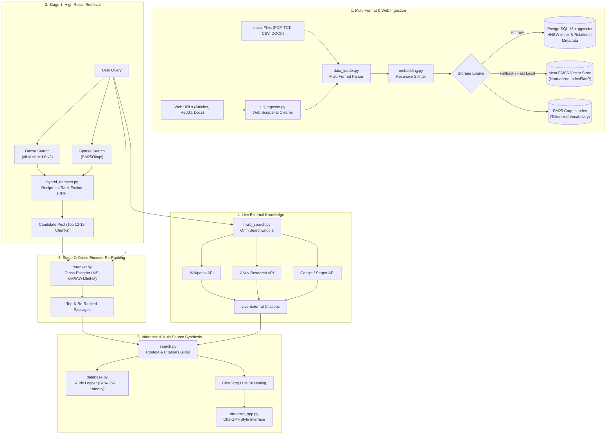

# NexusRAG Studio
### Enterprise Omni-Source RAG (Private Documents + Live Web + Two-Stage Re-Ranking)

NexusRAG Studio is an enterprise-grade Retrieval-Augmented Generation (RAG) platform designed for **Data Science & AI/ML engineering**. It synthesizes knowledge across both **private documents** and **live external resources** (Wikipedia, ArXiv, Google, Reddit, and arbitrary web URLs) using **hybrid BM25 + FAISS retrieval**, deep **Cross-Encoder re-ranking**, and **Groq's ultra-fast LLM inference**.

---

## Key Features

- **Omni-Source Knowledge Architecture**: Seamlessly fuses private local documents (`.pdf`, `.txt`, `.csv`, `.docx`, `.xlsx`, `.json`) with live external research (Wikipedia, ArXiv, and global search providers).
- **Universal URL Ingestion**: Paste any web article, Reddit discussion, or documentation URL in the sidebar to automatically scrape, clean, chunk, and index it into the local FAISS + BM25 vectorstore.
- **Two-Stage Information Retrieval Pipeline**: High-recall candidate generation (Hybrid RRF) paired with high-precision cross-attention re-ranking via MS-MARCO Cross-Encoder (`cross-encoder/ms-marco-MiniLM-L-6-v2`).
- **Hybrid Retrieval (BM25 + FAISS)**: Merges exact keyword matching with 384-dimensional dense semantic embeddings (`all-MiniLM-L6-v2`) via Reciprocal Rank Fusion (RRF).
- **Quantitative Evaluation Suite (`evaluate.py`)**: Automated benchmark comparing Dense, Sparse, Hybrid, and Two-Stage Re-Ranking on Hit Rate @ 3 and latency.
- **Granular Multi-Source Citations**: Every generated response includes expandable context inspector cards showing exact document names, page numbers, clickable web URLs, and relevance scores.
- **Ultra-Fast LLM Inference**: Integrated with Groq's API supporting state-of-the-art open models (`openai/gpt-oss-120b`, `openai/gpt-oss-20b`, `qwen/qwen3.8-27b`).
- **Agentic Query Planner & Decomposer**: Automatically recognizes compound or comparative queries, decomposing them into targeted parallel searches for comprehensive multi-hop retrieval.
- **Self-RAG Hallucination Guardrails**: Cross-examines generated claims against retrieved context passages to compute a factual Groundedness Score (`0% - 100%`) and flag unverified statements.
- **Real-Time LLMOps Observability**: Tracks the full retrieval waterfall, Time To First Token (TTFT), prompt/completion tokens, and real-time inference cost.
- **Persistent Chat Session Manager**: Threaded conversation management stored locally on disk with sidebar navigation, search history, and delete actions.
- **Enterprise-Grade Private Storage**: High-security PostgreSQL 16 database with `pgvector` (HNSW cosine index), cryptographic SHA-256 document deduplication, relational chunk metadata, and zero-trust audit logging.
- **Resilient Multi-Store Architecture**: Seamless dual-engine design—persists automatically to PostgreSQL + `pgvector` when active, with transparent automatic fallback to local FAISS when offline.
- **ChatGPT / Gemini Custom Component Input**: Custom in-capsule `+` attachment trigger modal with seamless Streamlit dialog integration.
- **Production Containerization**: Multi-stage `Dockerfile` and `docker-compose.yml` with private network-isolated PostgreSQL service (`127.0.0.1` binding).

---

## Quantitative Benchmark Results

Evaluated across ground-truth technical queries using [`evaluate.py`](file:///d:/RAG/evaluate.py):

| Retrieval Technique | Hit Rate @ 3 | Average Latency | Key Advantage |
| :--- | :---: | :---: | :--- |
| **BM25Okapi (Sparse Lexical)** | 100.0% | **0.5 ms** | Exact keyword & symbol precision |
| **FAISS MiniLM (Dense Semantic)** | 100.0% | 13.6 ms | Deep conceptual & semantic similarity |
| **Hybrid Search (Dense + BM25 via RRF)** | 100.0% | 13.0 ms | Robust to both synonyms & exact terms |
| **Two-Stage (Hybrid + Cross-Encoder)** | **100.0%** | **~175 ms** | **Full cross-attention scoring for maximum precision** |

---

## Architecture Flow



---

## Project Structure

```text
RAG/
├── app.py                      # Unified launcher (auto-switches to .venv)
├── evaluate.py                 # Automated 4-way retrieval benchmark
├── Dockerfile                  # Production container image
├── docker-compose.yml          # One-command orchestration (PostgreSQL + pgvector + App)
├── requirements.txt            # Python dependencies
├── .env.example                # Example configuration template
├── data/                       # Ingested documents
│   ├── pdf/                    # PDF documents
│   ├── text_files/             # Text & markdown documents
│   └── web_docs/               # Ingested web pages & articles
├── faiss_store/                # Local persisted vector database & metadata
└── src/
    └── rag/
        ├── __init__.py
        ├── data_loader.py      # Multi-format parser with page tracking
        ├── database.py         # Secure PostgreSQL + pgvector manager & audit logs
        ├── url_ingester.py     # Universal web & article scraper & ingester
        ├── embedding.py        # Chunking & SentenceTransformer embeddings
        ├── vectorstore.py      # FAISS vector store with normalized cosine distance
        ├── hybrid_retriever.py # BM25 + FAISS Reciprocal Rank Fusion (RRF)
        ├── reranker.py         # Cross-Encoder Re-Ranking (MS-MARCO MiniLM)
        ├── multi_search.py     # Live multi-source search (Wikipedia, ArXiv, Google)
        ├── search.py           # Multi-mode RAG engine with PostgreSQL mirroring
        ├── streamlit_app.py    # ChatGPT-style web UI with vector SVG icons
        └── frontend/
            └── index.html      # Gemini/ChatGPT-style input capsule with + attachment trigger
```

---

## Quick Start

### 1. Configure Environment
Copy `.env.example` to `.env` and add your keys:
```bash
cp .env.example .env
```
Key configurations in `.env`:
```env
GROQ_API_KEY=gsk_your_groq_api_key_here
SERPER_API_KEY=your_serper_key_here

# PostgreSQL + pgvector configuration
POSTGRES_HOST=localhost
POSTGRES_PORT=5432
POSTGRES_DB=nexusrag
POSTGRES_USER=postgres
POSTGRES_PASSWORD=your_secure_password_here
```

### 2. (Optional) Start Private PostgreSQL with pgvector
NexusRAG includes a hardened, private `docker-compose.yml` service bound strictly to `127.0.0.1` (no external network exposure):
```bash
docker compose up -d postgres
```
> [!NOTE]
> If PostgreSQL is not running, NexusRAG **automatically and gracefully falls back to local FAISS** without interrupting your workflow.

### 3. Launch NexusRAG Studio (Web UI)
Run in your terminal:
```bash
python app.py
```
Open your browser at:
**`http://localhost:8501`**

The top bar will show an indicator badge:
- 🟢 `PostgreSQL (pgvector)` when database is connected.
- 🟣 `FAISS VectorStore` when running in standalone local mode.

### 4. Run Quantitative Benchmark
Evaluate retrieval performance across Dense, Sparse, Hybrid, and Two-Stage Re-Ranking:
```bash
python app.py --eval
```

### 5. Ingesting Documents & Web URLs
- Click the **`+`** icon inside the chat capsule or open the sidebar to upload files (`.pdf`, `.docx`, `.txt`, `.csv`, `.xlsx`, `.json`).
- In the sidebar, expand **"Ingest Web URL / Article"**, enter any website, documentation, or Wikipedia URL, and click **"Fetch & Index URL"**.

